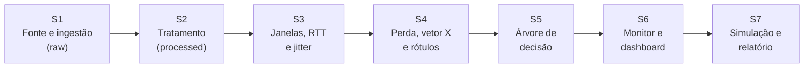

# 🚀 Scrum Framework: Preditor de Falha e Risco em Dispositivos de Rede

Projeto interdisciplinar (Redes de Computadores, Estrutura de Dados II e Análise de Sistemas) que treina uma **árvore de decisão** a partir de métricas reais de rede (latência, perda de pacotes e jitter) e a usa em um **dashboard em tempo real** que classifica cada dispositivo como **OK**, **RISCO** ou **FALHA**, com um **modo de simulação** para injetar eventos sob demanda.

---

## 👥 Equipe e Papéis

| Papel | Responsável | Responsabilidade |
| :--- | :--- | :--- |
| **Product Owner (PO)** | `[PREENCHER]` | Visão do produto, priorização do backlog e aceite das entregas. |
| **Scrum Master (SM)** | `[PREENCHER]` | Facilita os eventos, remove impedimentos e garante as práticas do Scrum. |
| **Development Team** | Vinicius Eduardo Santos de Oliveira, Giulia Ayumi Shimada Cardoso, Heitor Estrela de Andrade, Gabriel Romão da Silva, Miguel Augusto da Costa Souza | Coleta, tratamento, modelagem, dashboard e documentação. |

> Em equipe de cinco pessoas, PO e SM costumam ser acumulados com o papel de Dev. Indique quem acumula o quê.

**Orientadoras/Orientador:** Andrea Sakai, Denise de Souza, Luis de Oliveira (stakeholders das Sprint Reviews).

---

## ⚙️ Parâmetros do Projeto

| Parâmetro | Valor |
| :--- | :--- |
| Duração da sprint | 1 semana |
| Velocity de referência | 10 pontos/sprint (ajustar após a Sprint 2) |
| Fonte de dados (decidida no Memorando) | API do RIPE Atlas (alternativa descartada: CAIDA Ark, formato `.warts`) |
| Medição de treino | `28095697`, ping IPv4/ICMP, destino Unicast `150.164.1.222` (UFMG) |
| Janela de coleta | Últimas 6 h, step de 240 s (até 90 registros por sonda) |
| Coleta inicial | 13/09/2026, 90.802 registros, salva em `raw` |
| Vetor de características | `X = [latência, perda, jitter]` por janela |
| Classes | `OK`, `RISCO`, `FALHA` |
| Fuso local | `America/Sao_Paulo` |
| Formato `raw` | CSV + JSON original + JSON de metadados |
| Formato `processed` / `analytics` | Parquet (CSV só para tabelas legíveis em relatório) |

---

## 🗂️ Arquitetura de Camadas

| Camada | Pasta no Drive | Conteúdo |
| :--- | :--- | :--- |
| Bronze | `/ripe_atlas/raw` | JSON original, CSV bruto e metadados da coleta. Imutável. |
| Silver | `/ripe_atlas/processed` | Dados limpos, tipados e com timestamps normalizados (Parquet). |
| Gold | `/ripe_atlas/analytics` | Janelas, vetor `X`, rótulos e dataset de treino (Parquet). |
| Modelo | `/ripe_atlas/model` | Árvore treinada (`.joblib`) e relatório de avaliação. |

---

## 🔄 Rituais (Scrum Events)

* **Sprint Planning** (1h): define a **Sprint Goal** e seleciona itens do backlog.
* **Daily Scrum** (15 min, meet/chat): *O que fiz ontem? O que farei hoje? Há impedimentos?*
* **Sprint Review & Demo:** demonstração funcional às orientadoras.
* **Sprint Retrospective:** o que funcionou e o que melhorar.

---

## 📌 Visão Geral das Sprints

| Sprint | Objetivo | Pontos | Status |
| :---: | :--- | :---: | :---: |
| 1 | Fonte de dados e ingestão (raw) | 10 | ✅ Concluída |
| 2 | Tratamento (processed) | 10 | ✅ Concluída |
| 3 | Janelas, RTT e jitter | 10 | ✅ Concluída |
| 4 | Perda, vetor X e rotulagem | 10 | ✅ Concluída |
| 5 | Modelo: árvore de decisão | 10 | ✅ Concluída|
| 6 | Monitoramento ao vivo e dashboard | 10 | 📋 Planejada |
| 7 | Modo de simulação, testes e relatório | 10 | 📋 Planejada |

---

## ✅ Definition of Done (DoD) geral

1. Código versionado no Git (repositório `project-redes`) com commit descritivo e autoria identificável.
2. Notebook/script reexecutável do início ao fim em ambiente limpo (Google Colab).
3. Saídas salvas na pasta correta, com nome `<camada>_<descrição>_<AAAAMMDD>`.
4. Critérios de aceite verificados e registrados.
5. Validação básica feita (contagem de linhas, nulos, tipos).
6. Contribuição de cada integrante registrada com evidência (commit, PR, card do Trello/Notion).
7. Aceite do PO na Sprint Review.

---

## 🟢 Sprint 1: Fonte de Dados e Ingestão (`raw`)

> **Sprint Goal:** Decidir, com base em pesquisa, a fonte de dados e garantir uma coleta reprodutível do RIPE Atlas sem perda de integridade.
> **Status:** ✅ Concluída

* **US01 - Memorando de Decisão da Fonte de Dados:** *Como* equipe, *queremos* comparar dataset real (CAIDA Ark) e API do RIPE Atlas, *para que* a escolha seja sustentada por evidências.
  * **Aceite:** comparação por critérios; recomendação justificada; riscos e mitigações; fontes citadas. **Resultado:** API do RIPE Atlas.
* **US02 - Seleção do Alvo de Medição:** *Como* Analista de Rede, *quero* um alvo Unicast estável (UFMG, `28095697`), *para que* o RTT seja comparável entre sondas, sem o efeito Anycast (medição 1001, K-root, descartada).
  * **Aceite:** ID e IP de destino documentados; justificativa Unicast vs. Anycast registrada.
* **US03 - Integração com a API REST:** *Como* Engenheiro de Dados, *quero* consumir a API via `requests`, *para que* a coleta seja automatizada.
  * **Aceite:** janela de 6 h em UTC dinâmico; `raise_for_status()`, timeout e tratamento de erros; validação de lista não vazia.
* **US04 - Persistência Bruta:** *Como* Engenheiro de Dados, *quero* salvar JSON original, CSV e metadados em `/ripe_atlas/raw`, *para que* haja histórico imutável.
  * **Aceite:** nome com timestamp (sem sobrescrita); metadados com URL, parâmetros, horário e nº de registros; arquivos verificados por `assert`.

---

## 🟡 Sprint 2: Tratamento de Dados (`processed`)

> **Sprint Goal:** Limpar, padronizar e tipar os dados brutos em uma camada confiável.
> **Status:** ⏳ Em andamento

* **US05 - Tratamento de Perda e Valores Ausentes:** *Como* Analista de Dados, *quero* sinalizar `rcvd == 0` e converter RTT `-1.0`/`*` em nulo, *para que* ausências não distorçam a latência.
  * **Aceite:** coluna booleana `is_lost`; RTT ausente como `NaN` (nunca `0` ou `-1`); teste com amostra conhecida; duplicados (`prb_id` + `timestamp`) verificados.
* **US06 - Normalização Temporal:** *Como* Analista de Dados, *quero* converter Unix Epoch para `datetime` UTC e `America/Sao_Paulo`, *para que* a série temporal seja correta.
  * **Aceite:** `timestamp_utc` e `timestamp_local` timezone-aware; 3 registros conferidos manualmente.
* **US07 - Tipagem e Higienização:** *Como* Engenheiro de Dados, *quero* tipar os campos (`prb_id` inteiro, RTT float) e tratar a coluna `result` (lista aninhada), *para que* o dataset fique otimizado.
  * **Aceite:** schema documentado; sem colunas 100% nulas; decisão sobre `result` registrada.
* **US08 - Exportação em Parquet:** *Como* Engenheiro de Dados, *quero* salvar em `/ripe_atlas/processed` em Parquet, *para que* tipos e fuso sejam preservados.
  * **Aceite:** arquivo relido com schema idêntico; tamanho comparado ao raw.

---

## 🔵 Sprint 3: Janelas, RTT e Jitter

> **Sprint Goal:** Agrupar as medições em janelas por sonda e derivar latência e jitter.
> **Status:** 📋 Planejada

* **US09 - Janelas e Latência Média:** *Como* Engenheiro de Redes, *quero* agregar RTT por `prb_id` em janelas temporais, *para que* tendências de lentidão apareçam.
  * **Aceite:** tamanho de janela definido e justificado (ex.: 15 min); média, mediana, mín., máx. e contagem; janelas sem dados marcadas.
* **US10 - Jitter:** *Como* Engenheiro de Redes, *quero* calcular o jitter por sonda, *para que* a estabilidade do enlace seja avaliada.
  * **Definição:** `jitter = média(|RTT_i − RTT_(i−1)|)` entre medições consecutivas válidas da mesma sonda.
  * **Ordenação e isolamento:** ordenar por `prb_id` e `timestamp_utc` antes do `diff()` e calcular dentro de cada grupo (`groupby("prb_id")["rtt"].diff().abs()`), para que sondas diferentes não se misturem; a primeira medição de cada sonda fica `NaN`.
  * **Aceite:** fórmula documentada; pares com perda ignorados; validação à mão com duas sondas intercaladas.

---

## 🟠 Sprint 4: Perda, Vetor X e Rotulagem

> **Sprint Goal:** Completar o vetor `X = [latência, perda, jitter]` e rotular cada janela como OK, RISCO ou FALHA.
> **Status:** 📋 Planejada

* **US11 - Taxa de Perda por Janela:** *Como* Engenheiro de Redes, *quero* calcular `loss% = (sent − rcvd) / sent × 100` por janela, *para que* a degradação seja localizada.
  * **Aceite:** valores entre 0 e 100; agregação por sonda e janela.
* **US12 - Consolidação do Vetor X:** *Como* Engenheiro de Dados, *quero* um dataset único com `[latência, perda, jitter]` por janela, *para que* alimente o modelo.
  * **Aceite:** sem nulos não tratados; política para janelas incompletas documentada; saída em `/ripe_atlas/analytics`.
* **US13 - Regras de Rotulagem (OK / RISCO / FALHA):** *Como* Analista de Rede, *quero* regras explícitas e justificadas para rotular cada janela, *para que* o treino tenha alvo definido.
  * **Aceite:** limiares justificados (percentis dos dados e/ou referência técnica citada); distribuição das classes reportada; revisão pelo PO.

---

## 🟣 Sprint 5: Modelo — Árvore de Decisão

> **Sprint Goal:** Treinar, avaliar e persistir a árvore de decisão.
> **Status:** 📋 Planejada

* **US14 - Treino da Árvore:** *Como* Cientista de Dados, *quero* treinar uma árvore de decisão sobre `X`, *para que* classifique janelas em OK, RISCO ou FALHA.
  * **Aceite:** hiperparâmetros (ex.: profundidade) registrados; árvore visualizável.
* **US15 - Avaliação sem Vazamento:** *Como* Cientista de Dados, *quero* separar treino e teste por sonda e/ou tempo, *para que* a métrica reflita generalização real.
  * **Aceite:** matriz de confusão; precisão, revocação e F1 por classe; tratamento de desbalanceamento (FALHA tende a ser rara).
* **US16 - Persistência do Modelo:** *Como* Engenheiro de Dados, *quero* salvar o modelo (`.joblib`) com versão e métricas, *para que* o dashboard o carregue.
  * **Aceite:** modelo recarregado produz as mesmas predições; ordem das features documentada.

---

## 🔴 Sprint 6: Monitoramento ao Vivo e Dashboard

> **Sprint Goal:** Monitorar IPs da rede local via ping e exibir o estado de cada dispositivo em tempo real.
> **Status:** 📋 Planejada

* **US17 - Coletor de Ping Local:** *Como* Engenheiro de Redes, *quero* disparar pings periódicos para uma lista de IPs, *para que* latência, perda e jitter ao vivo sejam obtidos.
  * **Aceite:** lista de IPs configurável; janela deslizante com as mesmas definições do treino; timeout e tratamento de host inalcançável.
* **US18 - Classificação em Tempo Real:** *Como* Operador de Rede, *quero* que cada janela ao vivo seja classificada pelo modelo, *para que* o estado seja OK, RISCO ou FALHA.
  * **Aceite:** mesmas features e escala do treino; latência de inferência registrada.
* **US19 - Dashboard:** *Como* Operador de Rede, *quero* um painel com o estado atual e o histórico de cada dispositivo, *para que* problemas sejam vistos rapidamente.
  * **Aceite:** cor por classe; atualização automática; histórico de latência/perda/jitter por IP.

---

## ⚫ Sprint 7: Simulação, Testes e Relatório

> **Sprint Goal:** Validar a reação do sistema a cenários forçados e entregar a documentação final.
> **Status:** 📋 Planejada

* **US20 - Modo de Simulação:** *Como* Avaliador, *quero* injetar sob demanda picos de latência, perda e jitter, *para que* a reação do classificador seja validada.
  * **Aceite:** eventos simulados claramente identificados no dashboard; cenários OK→RISCO→FALHA e retorno reproduzíveis; simulação nunca grava no histórico real sem marcação.
* **US21 - Testes Integrados:** *Como* equipe, *queremos* testar o fluxo coleta → classificação → dashboard, *para que* a integração seja confiável.
  * **Aceite:** roteiro de teste com resultados registrados; falhas conhecidas listadas.
* **US22 - Relatório Final:** *Como* Product Owner, *quero* um documento com método, métricas, limitações e conclusões, *para que* o projeto seja apresentado e arquivado.
  * **Aceite:** metodologia, resultados do modelo, evidências da simulação, limitações e contribuições individuais.

---

## 🛠️ Matriz de Priorização (Sprint Backlog)

| ID | Descrição | Disciplina | Prioridade | Pontos | Sprint | Status |
| :--- | :--- | :--- | :---: | :---: | :---: | :---: |
| **US01** | Memorando de decisão da fonte | Análise de Sistemas | Alta | 2 | 1 | ✅ Done |
| **US02** | Alvo Unicast UFMG | Redes | Alta | 2 | 1 | ✅ Done |
| **US03** | Integração com a API RIPE Atlas | Redes | Alta | 3 | 1 | ✅ Done |
| **US04** | Persistência bruta em `raw` | Estrutura de Dados II | Alta | 3 | 1 | ✅ Done |
| **US05** | Perda e valores ausentes | Redes | Alta | 3 | 2 | ⏳ In Progress |
| **US06** | Normalização temporal | Estrutura de Dados II | Média | 2 | 2 | ⏳ In Progress |
| **US07** | Tipagem e higienização | Estrutura de Dados II | Média | 3 | 2 | 📋 To Do |
| **US08** | Exportação CSV (`processed`) | Estrutura de Dados II | Alta | 2 | 2 | 📋 To Do |
| **US09** | Janelas e latência média | Redes | Alta | 5 | 3 | 📋 To Do |
| **US10** | Jitter | Redes | Alta | 5 | 3 | 📋 To Do |
| **US11** | Taxa de perda por janela | Redes | Alta | 3 | 4 | 📋 To Do |
| **US12** | Consolidação do vetor X | Estrutura de Dados II | Alta | 2 | 4 | 📋 To Do |
| **US13** | Regras de rotulagem | Redes / Análise | Alta | 5 | 4 | 📋 To Do |
| **US14** | Treino da árvore de decisão | Estrutura de Dados II | Alta | 5 | 5 | 📋 To Do |
| **US15** | Avaliação sem vazamento | Estrutura de Dados II | Alta | 3 | 5 | 📋 To Do |
| **US16** | Persistência do modelo | Estrutura de Dados II | Média | 2 | 5 | 📋 To Do |
| **US17** | Coletor de ping local | Redes | Alta | 3 | 6 | 📋 To Do |
| **US18** | Classificação em tempo real | Estrutura de Dados II | Alta | 2 | 6 | 📋 To Do |
| **US19** | Dashboard | Análise de Sistemas | Alta | 5 | 6 | 📋 To Do |
| **US20** | Modo de simulação | Redes / Análise | Alta | 5 | 7 | 📋 To Do |
| **US21** | Testes integrados | Análise de Sistemas | Média | 2 | 7 | 📋 To Do |
| **US22** | Relatório final | Análise de Sistemas | Alta | 3 | 7 | 📋 To Do |

---

## ⚠️ Riscos e Dependências

| Risco / Dependência | Impacto | Mitigação |
| :--- | :--- | :--- |
| **Rótulos derivados de regras** (o modelo pode apenas reaprender o limiar) | Acurácia alta sem valor preditivo real | Definir regras na US13 com justificativa; reportar o modelo contra uma baseline por regra; usar janela futura (prever o estado seguinte) se possível. |
| **Diferença de domínio:** treino em enlaces RIPE → UFMG, produção na rede local | Classificação enviesada ao vivo | Documentar a limitação; considerar coletar uma amostra local para calibrar ou validar. |
| Classes desbalanceadas (FALHA rara) | Modelo ignora a classe crítica | Pesos de classe, reamostragem e métricas por classe. |
| Vazamento entre treino e teste (janelas da mesma sonda) | Métrica otimista | Divisão por sonda e/ou tempo (US15). |
| ICMP bloqueado por firewall em alguns dispositivos | Falsos positivos de FALHA | Distinguir "sem resposta por política" de falha; lista de IPs validada antes. |
| Limites da API (créditos, rate limit 429, assincronia) e disponibilidade externa | Coleta interrompida | Medições públicas, polling espaçado, backoff e retry (conforme Memorando); chave em variável de ambiente. |
| Cobertura desigual de sondas (Brasil) | Amostra pouco representativa | Reportar nº de sondas e limitação da amostra. |
| Simulação confundida com dado real | Histórico contaminado | Marcação explícita (`is_simulated`) e armazenamento separado. |
| Velocity de 10 pt com 7 sprints | Atraso em cascata | Reavaliar após a Sprint 2; tratar US13 e US19 como pontos de atenção. |

---
